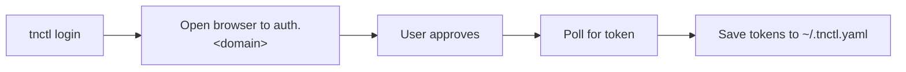

# `tnctl login`

Authenticate with the Teknoir platform using the OAuth2 **Device Authorization Flow**.

## Synopsis

```bash
tnctl login [flags]
```

The command attempts to open your default browser to complete the login. If it cannot open a browser,
it prints a verification URL and a one-time code for you to enter manually.

## Flags

| Flag | Default | Description |
| --- | --- | --- |
| `--realm` | `master` | Keycloak realm to authenticate against. |
| `--client-id` | `teknoir-cli` | OAuth2 client ID. |
| `--check` | off | Do not log in: check that the stored login works. Exit 0 when the access token is valid or a refresh succeeds, exit 6 when the login has expired. Prints the user and the expiry, never a token. See [Checking the login](#checking-the-login). |
| `--no-browser` | off | Do not try to open a browser; print the login URL and code. This is the default over SSH or without a display. Use it in agents and containers. |

Plus all [global flags](index.md#global-flags) — notably `--domain`.

## How it works

1. The issuer URL is derived from the active domain: `https://auth.<domain>/auth/realms/<realm>`.
2. A device-authorization request is made with PKCE (`S256`) and scopes `openid profile email offline_access`.
3. Your browser opens to approve the login; `tnctl` polls for completion.
4. On success, the access token, refresh token, expiry, realm, and client ID are saved under the
   domain's entry in `~/.tnctl.yaml`.



## Examples

```bash
# Log in to the default/active domain
tnctl login

# Log in to a specific environment
tnctl login --domain teknoir.cloud

# Use a non-default realm
tnctl login --realm customers
```

## Checking the login

```bash
tnctl login --check            # human readable
tnctl login --check -o json    # {"domain","user","accessExpires","refreshed","offline","refreshExpires"?}
```

`--check` never opens a browser and never prints a token. It uses the stored access token while it is valid;
otherwise it redeems the refresh token (and saves the renewed tokens, as every command does). It exits:

| Exit | Meaning |
| --- | --- |
| 0 | The login works. The output names the user, when the access token ends, and (when known) when the login itself ends. |
| 6 | There is no login, or it has expired: `Your tnctl login has expired. Run: tnctl login` (with `-o json`: `{"error":{"code":"session_expired",...}}`). |
| 1 | The check could not be made, for example because the platform is not reachable. This does not say the login is dead; try again. |

Use it in scripts and agents before a long job: `tnctl login --check || tnctl login --no-browser`.

## When the login expires

The access token lives a few minutes; `tnctl` renews it with the refresh token on every command. The refresh
token is an *offline* token: it does not end with your browser session, but it stops working when it is
revoked (an admin or you ended the session), your user is disabled, it has been unused for the realm's offline idle
timeout (30 days by default), or the platform's login service was reset.

Every command then ends the same way, with exit code 6 (the "not logged in" code):

```text
Error: Your tnctl login has expired. Run: tnctl login
```

With `-o json` the error code is `session_expired` (`not logged in` and rejected tokens stay `auth`):
`{"error":{"code":"session_expired","message":"Your tnctl login has expired. Run: tnctl login"}}`.
Long-running commands behave the same: `--wait` stops at the next poll, and `ssh`, `port-forward` and
`socks-proxy` over WireGuard end the tunnel when the next renewal needs a new token. A network problem while
renewing is **not** reported as an expired login: `--wait` retries it, and other commands print the network error.

## Notes

- Because `offline_access` is requested, `tnctl` receives a refresh token and can renew expired
  access tokens automatically on subsequent commands. If the platform does not grant it, `tnctl login`
  warns that the login ends with the access token; ask a platform admin to allow `offline_access` for the
  `teknoir-cli` client.
- A token is renewed when it has less than min(60 s, half its lifetime) left.
- Use `--debug` to print the resolved issuer URL and client ID.

## See also

- [Configuration](../configuration.md) — where tokens are stored.
- [`domain`](domain.md) / [`add`](add.md) — manage which domains you can log into.
