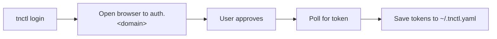

# `tnctl login`

Authenticate with the Teknoir platform using the OAuth2 **Device Authorization Flow**.

## Synopsis

```bash
tnctl login [flags]
```

The command attempts to open your default browser to complete the login. If it cannot open a browser,
it prints a verification URL and a one-time code for you to enter manually.

## Flags

| Flag | Default | Description |
| --- | --- | --- |
| `--realm` | `master` | Keycloak realm to authenticate against. |
| `--client-id` | `teknoir-cli` | OAuth2 client ID. |

Plus all [global flags](index.md#global-flags) — notably `--domain`.

## How it works

1. The issuer URL is derived from the active domain: `https://auth.<domain>/auth/realms/<realm>`.
2. A device-authorization request is made with PKCE (`S256`) and scopes `openid profile email offline_access`.
3. Your browser opens to approve the login; `tnctl` polls for completion.
4. On success, the access token, refresh token, expiry, realm, and client ID are saved under the
   domain's entry in `~/.tnctl.yaml`.



## Examples

```bash
# Log in to the default/active domain
tnctl login

# Log in to a specific environment
tnctl login --domain teknoir.cloud

# Use a non-default realm
tnctl login --realm customers
```

## Notes

- Because `offline_access` is requested, `tnctl` receives a refresh token and can renew expired
  access tokens automatically on subsequent commands.
- Use `--debug` to print the resolved issuer URL and client ID.

## See also

- [Configuration](../configuration.md) — where tokens are stored.
- [`domain`](domain.md) / [`add`](add.md) — manage which domains you can log into.
