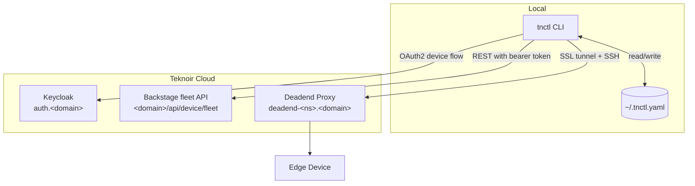
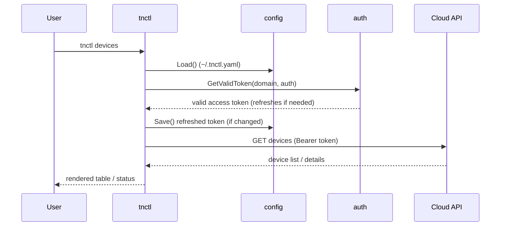

# Architecture

`tnctl` is a Go application built on [Cobra](https://github.com/spf13/cobra) (commands) and
[Viper](https://github.com/spf13/viper) (configuration). It acts as a thin, secure client over
Teknoir's cloud APIs and edge-access infrastructure.

## High-level overview

## Source layout

| Path | Responsibility |
| --- | --- |
| `main.go` | Entry point; calls `cmd.Execute()`. |
| `cmd/` | One file per Cobra command (`login`, `ns`, `device`, `ssh`, …). |
| `cmd/root.go` | Root command, persistent flags, config initialization. |
| `pkg/config` | Loading/saving `~/.tnctl.yaml`, domain & namespace resolution. |
| `pkg/auth` | Token validation and refresh. |
| `pkg/api` | HTTP client (User-Agent, 401/403 handling) and the fleet API: teamspaces, devices, device logins, robots, configuration. |
| `pkg/templates` | Text templates for the `bootstrap` provisioning scripts. |
| `pkg/ui` | Terminal rendering of device status and summaries. |

## Request lifecycle

For a typical data command (e.g. `tnctl devices`):

## Authentication

- Uses the OAuth2 **Device Authorization Flow** with PKCE (`S256`).
- Issuer URL: `https://auth.<domain>/auth/realms/<realm>` (default realm `master`).
- Default client ID: `teknoir-cli`.
- Tokens are persisted per-domain under `auths` in the config and **refreshed automatically** when
  expired; refreshed tokens are written back to the config.

## Edge access

Remote-access commands (`ssh`, `port-forward`, `socks-proxy`) do not talk to a custom protocol — they
build an `ssh` invocation that tunnels through the namespace **deadend** proxy
(`deadend-<namespace>.<domain>:2222`) using `ncat --ssl`, then connect to the device's remote-access
port. See **[Remote Access](remote-access.md)** for the full picture.
