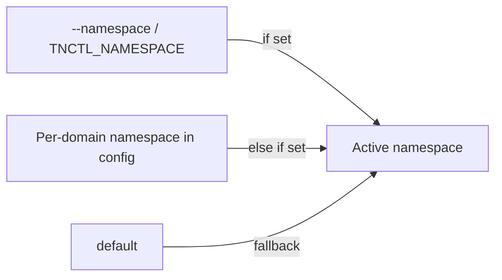

# Contexts: Domain & Namespace

A **context** in `tnctl` is the pair of values that almost every command operates against:

- the active **domain** (which Teknoir environment), and
- the active **namespace** (which logical tenant/project within that domain).

Both are stored persistently in `~/.tnctl.yaml`, so you don't need to repeat `--domain`/`--namespace`
on every invocation.

## Domains

A domain is a Teknoir environment such as `teknoir.cloud`. Each domain you log into gets its own entry
under `auths` in the config, holding both its credentials and its currently-selected namespace.

```bash
# Add a new domain (and switch to it)
tnctl add domain customer.teknoir.cloud

# Interactively switch between configured domains
tnctl domain
```

Switching a domain with `tnctl domain` also restores that domain's last-used namespace, so jumping
between environments preserves the full context.

## Namespaces

Within a domain, work is scoped to a namespace. The namespace can be selected interactively or by name:

```bash
tnctl ns                 # interactive fuzzy-finder over live namespaces
tnctl ns my-namespace    # set directly
```

The selected namespace is saved against the active domain in the config.

## How the active values are resolved



- **Domain** precedence: `--domain` flag / `TNCTL_DOMAIN` env var → config `domain` → default `teknoir.cloud`.
- **Namespace** precedence: `--namespace` flag / `TNCTL_NAMESPACE` env var → per-domain `namespace`
  in config → `default`.

!!! tip "One-off overrides"
    You can always override the saved context for a single command without changing your saved state:

    ```bash
    tnctl devices --domain other.teknoir.cloud --namespace staging
    ```

See **[Configuration](../configuration.md)** for the full file layout and precedence rules.
