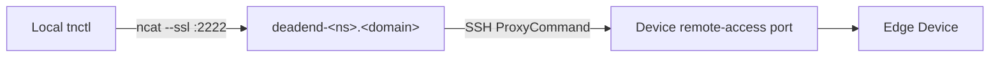
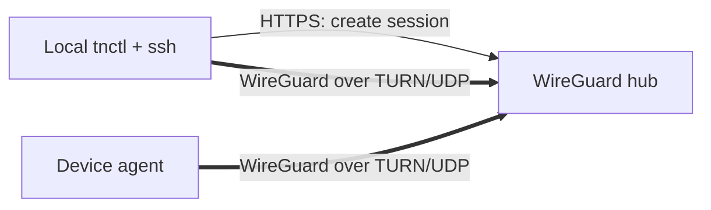

# Remote Access

`tnctl` provides three commands for securely reaching edge devices from your laptop:

- [`ssh`](../commands/ssh.md) — an interactive shell on the device.
- [`port-forward`](../commands/port-forward.md) — forward a local port to a service on the device's network.
- [`socks-proxy`](../commands/socks-proxy.md) — a SOCKS5 proxy onto the device's entire network.

All three share the same secure transport.

## Prerequisites

- **Remote Access enabled** for the target device in the Teknoir Console. If it is not, `tnctl` exits
  with a clear error instructing you to enable it.
- Local `ssh` client and `ncat` (from the Nmap suite) available on your `PATH`.

## How the tunnel is built

When you run a remote-access command, `tnctl`:

1. Fetches the device details from the cloud API and verifies remote access is active.
2. Decodes the device's base64-encoded **username** and **RSA private key**, writing the key to a
   temporary file with `0600` permissions (removed automatically when the command exits).
3. Builds an `ssh` command that uses a `ProxyCommand` chaining through the namespace **deadend** host
   (`deadend-<namespace>.<domain>`), wrapping the connection in TLS via `ncat --ssl`.
4. Connects to the device's remote-access port and applies the relevant mode flag.

The SSH options used harden and stabilize the session:

- `UserKnownHostsFile=/dev/null` and `StrictHostKeyChecking=no` — the ephemeral proxy host changes,
  so host-key prompts are suppressed.
- `ServerAliveInterval=60` — keep long-lived tunnels alive.
- `ExitOnForwardFailure=yes` — fail fast if a forward cannot be established.

## Mode-specific behavior

| Command | SSH flag | Effect |
| --- | --- | --- |
| `ssh` | (interactive) | Wires `stdin`/`stdout`/`stderr` to an interactive shell. |
| `port-forward` | `-L <local>:<host>:<port>` | Local port forwarding to a target on the device network. |
| `socks-proxy` | `-D <port>` | Dynamic SOCKS5 proxy. |

`port-forward` additionally recognizes common web ports (80, 443, 3000, 5000, 8080, 8443, 9000, 9090)
and prints a ready-to-click `http(s)://localhost:<port>` URL.

## WireGuard (ZTNA) path

`tnctl ssh --wireguard` and `tnctl port-forward --wireguard` reach the device through a different
transport that is built for zero trust access. It runs next to the SSH tunnel described above.
`port-forward --wireguard` forwards a named device service (a web UI, or a Kubernetes Service inside
the device) to a local port, and `tnctl wg status` shows how a device is reachable.

Both try a **direct** path first: a peer-to-peer WireGuard session between your machine and the device
(on the same LAN, or through NAT), so the hub carries no traffic. If that does not come up within
about 2.5 seconds, the hub relays the connection as described below. Use `--no-p2p` to skip the direct
path.

How it works:

1. `tnctl` asks the WireGuard hub (`https://wg.<domain>`) for a session to one device and one port
   (22), authenticating with your `tnctl login` token. The hub checks your access to the teamspace
   and the device's state before it answers.
2. The hub returns a WireGuard session and the device's SSH host keys. `tnctl` brings up a userspace
   WireGuard tunnel (no root, no network interface) to the hub, relayed over UDP through a TURN
   gateway, so no inbound ports are needed on your side or on the device.
3. `ssh` runs with `ProxyCommand` pointing at `tnctl wg-proxy`, which pipes the SSH stream through the
   tunnel. The host keys from step 2 are written to a temporary `known_hosts`, and `ssh` runs with
   `StrictHostKeyChecking=yes`: the device must present exactly those keys.
4. The hub splices the stream to the device's own, outbound-connected agent. You never get network
   access to the device or its network, only the one port you asked for.

Sessions are short-lived and renewed with a fresh credential every time. The hub re-checks the device
and your access on each renewal. If the device is flagged compromised, fails its health check, or you
lose access, new sessions are refused and open ones are ended at once. `tnctl` prints a single
`tnctl: wireguard: <reason>: <message>` line and exits with status 1.

Differences from the SSH tunnel path: it does not need Remote Access to be enabled, it does not need
`ncat`, and the SSH host key is verified instead of ignored. See
[`tnctl ssh`](../commands/ssh.md#wireguard-ztna-path-wireguard) for flags and requirements.

## Security notes

- Private keys are **never** written to your project directory — only to a temporary file that is
  deleted when the command finishes.
- Credentials are fetched on demand from the cloud API using your authenticated session; they are not
  cached on disk by these commands.
- For `ssh`, if the device exposes a password it is printed once for convenience; treat it as sensitive.
