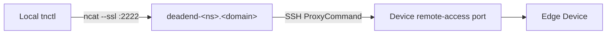

# Remote Access

`tnctl` provides three commands for securely reaching edge devices from your laptop:

- [`ssh`](../commands/ssh.md) — an interactive shell on the device.
- [`port-forward`](../commands/port-forward.md) — forward a local port to a service on the device's network.
- [`socks-proxy`](../commands/socks-proxy.md) — a SOCKS5 proxy onto the device's entire network.

All three share the same secure transport.

## Prerequisites

- **Remote Access enabled** for the target device in the Teknoir Console. If it is not, `tnctl` exits
  with a clear error instructing you to enable it.
- Local `ssh` client and `ncat` (from the Nmap suite) available on your `PATH`.

## How the tunnel is built

When you run a remote-access command, `tnctl`:

1. Fetches the device details from the cloud API and verifies remote access is active.
2. Decodes the device's base64-encoded **username** and **RSA private key**, writing the key to a
   temporary file with `0600` permissions (removed automatically when the command exits).
3. Builds an `ssh` command that uses a `ProxyCommand` chaining through the namespace **deadend** host
   (`deadend-<namespace>.<domain>`), wrapping the connection in TLS via `ncat --ssl`.
4. Connects to the device's remote-access port and applies the relevant mode flag.

The SSH options used harden and stabilize the session:

- `UserKnownHostsFile=/dev/null` and `StrictHostKeyChecking=no` — the ephemeral proxy host changes,
  so host-key prompts are suppressed.
- `ServerAliveInterval=60` — keep long-lived tunnels alive.
- `ExitOnForwardFailure=yes` — fail fast if a forward cannot be established.

## Mode-specific behavior

| Command | SSH flag | Effect |
| --- | --- | --- |
| `ssh` | (interactive) | Wires `stdin`/`stdout`/`stderr` to an interactive shell. |
| `port-forward` | `-L <local>:<host>:<port>` | Local port forwarding to a target on the device network. |
| `socks-proxy` | `-D <port>` | Dynamic SOCKS5 proxy. |

`port-forward` additionally recognizes common web ports (80, 443, 3000, 5000, 8080, 8443, 9000, 9090)
and prints a ready-to-click `http(s)://localhost:<port>` URL.

## Security notes

- Private keys are **never** written to your project directory — only to a temporary file that is
  deleted when the command finishes.
- Credentials are fetched on demand from the cloud API using your authenticated session; they are not
  cached on disk by these commands.
- For `ssh`, if the device exposes a password it is printed once for convenience; treat it as sensitive.
