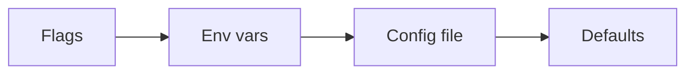

# Configuration

`tnctl` is configured through a combination of a YAML file, environment variables, and command-line
flags. Configuration is powered by [Viper](https://github.com/spf13/viper).

## Configuration file

By default, `tnctl` reads and writes `~/.tnctl.yaml`. If the file does not exist on first run, the CLI
creates it with sensible defaults.

Use a different file with the global `--config` flag:

```bash
tnctl --config /path/to/custom.yaml devices
```

### File structure

```yaml
domain: teknoir.cloud          # the currently active domain
auths:                         # per-domain credentials and context
  teknoir_cloud:               # key: domain with dots replaced by underscores
    access_token: "..."
    refresh_token: "..."
    expiry: "2026-06-25T10:00:00Z"
    realm: master
    client_id: teknoir-cli
    namespace: my-namespace    # active namespace for this domain
```

!!! info "Why are dots replaced with underscores?"
    Viper treats dots as nested-key separators, so domain keys under `auths` store `teknoir.cloud`
    as `teknoir_cloud`. The CLI converts back and forth automatically when displaying domains.

### Per-domain context

Each domain under `auths` carries its **own** namespace and credentials. Switching domains with
`tnctl domain` therefore also restores that domain's last-used namespace.

| Field | Description |
| --- | --- |
| `access_token` | OAuth2 access token obtained from `tnctl login`. |
| `refresh_token` | Used to silently refresh expired access tokens. |
| `expiry` | RFC 3339 timestamp of access-token expiry. |
| `realm` | Keycloak realm (default `master`). |
| `client_id` | OAuth2 client ID (default `teknoir-cli`). |
| `namespace` | The active namespace for this domain (default `default`). |

## Environment variables

Variables prefixed with `TNCTL_` are read automatically:

```bash
export TNCTL_DOMAIN=teknoir.cloud
export TNCTL_NAMESPACE=my-namespace
export TNCTL_DEVICE=my-device
```

## Precedence

Settings are resolved in the following order (highest wins):



1. **Flags** — e.g. `--domain`, `--namespace`, `--device`.
2. **Environment variables** — e.g. `TNCTL_NAMESPACE`.
3. **Config file** — `~/.tnctl.yaml` (per-domain values under `auths`).
4. **Defaults** — domain `teknoir.cloud`, namespace `default`.

### Namespace resolution

The active namespace specifically resolves as:

1. `--namespace` flag / `TNCTL_NAMESPACE` env var, then
2. the per-domain `namespace` stored under `auths`, then
3. the fallback value `default`.

## Global flags

These persistent flags are available on every command:

| Flag | Shorthand | Description |
| --- | --- | --- |
| `--domain` | `-d` | Teknoir domain (e.g. `teknoir.cloud`). |
| `--namespace` | `-n` | Target namespace. |
| `--device` | | Target device ID. |
| `--config` | | Path to a config file (default `~/.tnctl.yaml`). |
| `--debug` | | Enable verbose debug output. |

!!! tip "Domain → auth endpoint"
    When you provide a base domain such as `teknoir.cloud`, `tnctl` derives the authentication
    endpoint by prefixing it with `auth.` — i.e. `auth.teknoir.cloud`. Keycloak is served under the
    `/auth` subpath of that host.
