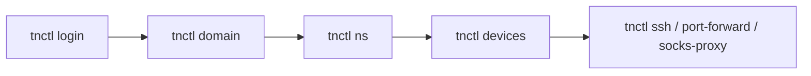

# Getting Started

This guide walks you through your first session with `tnctl`: authenticating, choosing a context,
inspecting devices, and opening a secure connection.

!!! note "Prerequisites"
    - `tnctl` installed and on your `PATH` (see **[Installation](installation.md)**).
    - A Teknoir account with access to at least one namespace.
    - `ssh` and `ncat` available locally for the remote-access commands.

## 1. Authenticate

```bash
tnctl login
```

`tnctl` starts an OAuth2 **Device Authorization Flow** and opens your default browser. If the browser
cannot be opened automatically, the CLI prints a URL and a one-time code to enter manually.

Targeting a specific environment? Pass `--domain`:

```bash
tnctl login --domain teknoir.cloud
```

On success, your tokens are stored in `~/.tnctl.yaml`, scoped to that domain. See
**[Configuration](configuration.md)** for details.

## 2. Choose your context

`tnctl` keeps a persistent **context** — the active **domain** and **namespace**.

```bash
# Switch domain (interactive fuzzy-finder over configured domains)
tnctl domain

# Switch namespace (interactive if no argument is given)
tnctl ns
tnctl ns my-namespace
```

Learn more in **[Contexts (Domain & Namespace)](concepts/contexts.md)**.

## 3. Inspect your fleet

```bash
# A summary table of every device in the current namespace
tnctl devices

# Filter by metadata labels
tnctl devices env=prod region=us-east

# Detailed status for one device (interactive picker if omitted)
tnctl device my-device
```

## 4. Connect to a device

```bash
# Interactive SSH session
tnctl ssh my-device

# Forward a local port to a service on the device's network
tnctl port-forward my-device 8080:localhost:80

# Open a SOCKS5 proxy into the device's network
tnctl socks-proxy my-device 1080
```

!!! warning "Tunneling must be active"
    The `ssh`, `port-forward`, and `socks-proxy` commands need an active tunnel for the target device
    (WireGuard, or the deprecated legacy SSH tunnel as a fallback). Turn it on under Tunneling on the device
    page in the Teknoir console; if it is off, `tnctl` says so. `socks-proxy` works over the legacy tunnel
    only, and `port-forward` forwards a device service (`tnctl port-forward <device>` lists them).

## A typical workflow



## Next steps

- Understand the config file: **[Configuration](configuration.md)**.
- Browse every command: **[Command Reference](commands/index.md)**.
- See how tunnels work under the hood: **[Remote Access](concepts/remote-access.md)**.
