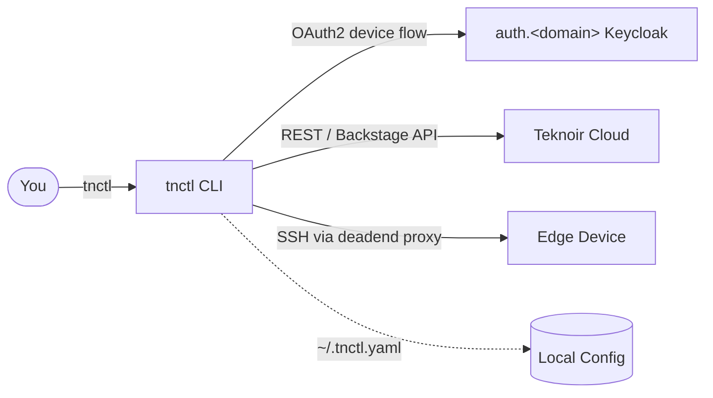

# tnctl — Teknoir Control

`tnctl` is the **official command-line interface for managing Teknoir cloud resources and edge devices**.
It gives you a fast, scriptable, and secure way to authenticate, switch between environments, inspect
fleets of devices, and open secure tunnels straight into the edge — all from your terminal.

!!! tip "TL;DR"
    ```bash
    # Install
    curl -sSL https://raw.githubusercontent.com/teknoir/cli/main/scripts/install.sh | sh

    # Authenticate
    tnctl login

    # Pick a namespace and inspect your fleet
    tnctl ns
    tnctl devices

    # Jump onto a device
    tnctl ssh
    ```

## What can it do?

<div class="grid cards" markdown>

- :material-login: **Authenticate**

    Browser-based OAuth2 Device Authorization Flow against Teknoir's Keycloak. No copy-pasting secrets.

- :material-swap-horizontal: **Switch context**

    Manage multiple domains and namespaces with interactive fuzzy-finders and a persistent config.

- :material-monitor-dashboard: **Inspect devices**

    Print rich, color-coded status for a single device or a summary table for the whole fleet.

- :material-lan-connect: **Connect securely**

    `ssh`, `port-forward`, and `socks-proxy` directly into edge devices through Teknoir's proxy.

- :material-rocket-launch: **Bootstrap edges**

    Generate ready-to-run provisioning scripts for new agents and servers.

</div>

## How it fits together



## Where to go next

- New here? Start with **[Installation](installation.md)** and the **[Getting Started](getting-started.md)** guide.
- Want to understand the config file and precedence rules? See **[Configuration](configuration.md)**.
- Looking for a specific command? Jump to the **[Command Reference](commands/index.md)**.
- Curious how secure tunnels work? Read **[Remote Access](concepts/remote-access.md)**.

!!! info "Project facts"
    - **Binary name:** `tnctl`
    - **Go module:** `teknoir/cli`
    - **Default domain:** `teknoir.cloud`
    - **Config file:** `~/.tnctl.yaml`
    - **License:** Apache 2.0
